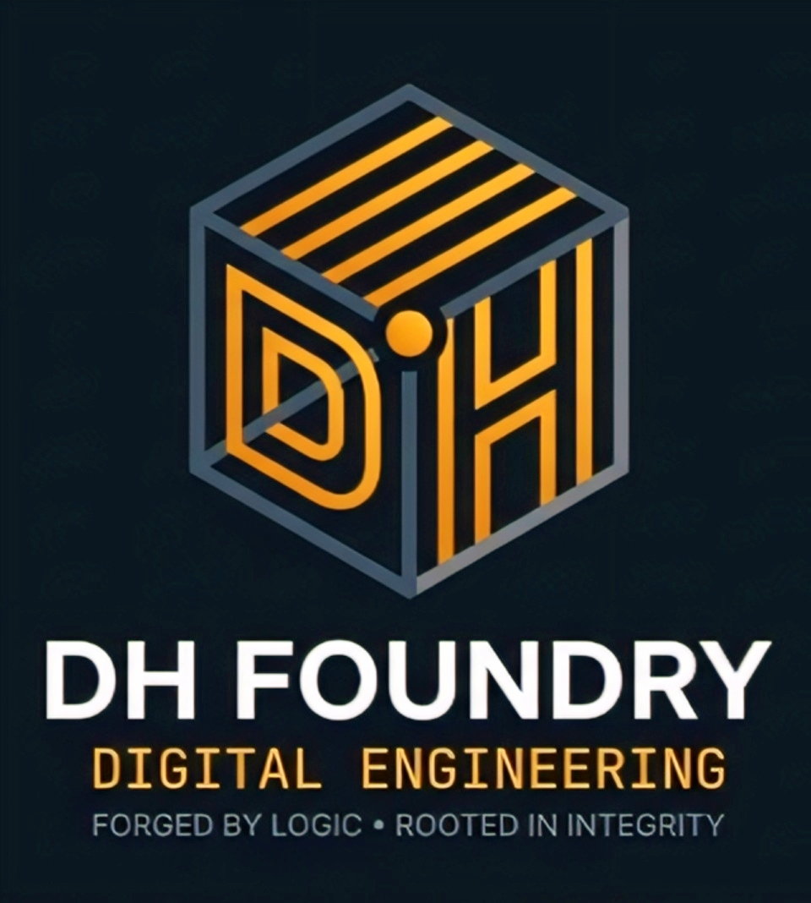

<h1 align="center">Tentang kami</h1>

  

  <em>"Forged by Logic • Rooted in Integrity"</em>

  
  
  

---

### 👨‍💻 About the Founder
Saya adalah **Muhammad Luqman Hakim**, seorang *Software Engineer* dan pendiri **DH Foundry** yang lahir dan tumbuh sebagai putra daerah dari wilayah ibukota kabupaten cirebon **Sumber, Cirebon**. Berfokus pada perancangan arsitektur perangkat lunak, rekayasa basis data relasional, dan pengembangan aplikasi web kustom yang terukur.

Dengan pengalaman membangun berbagai solusi digital—mulai dari sistem informasi publik daerah (seperti proyek geospasial di Bapperida Kabupaten Cirebon), platform keorganisasian, hingga utilitas web modern—saya berdedikasi membawa semangat lokal Cirebon ke kancah rekayasa teknologi nasional. Saya memegang prinsip teguh bahwa setiap baris kode harus ditempa di atas **fondasi logika komputasi yang presisi** dan **integritas moral yang kuat**.

---

### 🚀 About DH Foundry
**DH Foundry** adalah studio rekayasa digital independen yang berfokus pada pengembangan sistem web kustom, arsitektur basis data relasional yang kokoh, serta integrasi solusi digital berstandar tinggi. Setiap baris kode ditempa dengan presisi, memadukan keandalan logika rekayasa perangkat lunak dan integritas moral yang kuat.

---

### 🏛️ Core Brand Philosophy (Spiritual & Engineering Synthesis)
Arsitektur sistem dan identitas brand **DH Foundry** dibentuk oleh harmoni antara rekayasa teknologi dan nilai-nilai fundamental:

* **01 Root Origin / Tauhid (Single Source of Truth):** Segala logika komputasi, kebaikan, dan ikhtiar bermuara pada satu titik poros utama.
* **05 Pillars / Rukun Islam (5-Layer Architecture):** Sistem dibangun di atas 5 lapisan kokoh: *UI/Client → API Gateway → Business Logic → Security Layer → Relational Database*.
* **05 Time Strokes / Sholat 5 Waktu (SDLC Pipeline):** Kedisiplinan waktu harian yang selaras dengan 5 fase siklus hidup software: *Discovery → Design → Development → Testing → Deployment*.
* **06 Quality Axes / Rukun Iman (ISO/IEC 25010 Standards):** Enam pilar standar mutu software: *Reliability, Security, Performance, Maintainability, Usability, & Scalability*.

---

### 🌐 Here are some of my works created over the past few years
#### 1. 🕌 LDK Al-Hidayah Management Platform — [🔗 Live Demo](https://ldk-al-hidayah.vercel.app/)
* **Deskripsi:** Platform ekosistem digital terpadu untuk Lembaga Dakwah Kampus Al-Hidayah. Dirancang untuk mentransformasi manajemen keorganisasian konvensional menjadi terpusat, modern, dan mudah diakses oleh seluruh anggota maupun jamaah.
* **Fitur Utama:** Pusat informasi & warta organisasi, manajemen agenda/event dakwah interaktif, repositori dokumentasi kegiatan, serta portal struktur kepengurusan.
* **Fokus Rekayasa:** Optimasi antarmuka intuitif, navigasi cepat berbasis web modern, dan penyajian data organisasi secara terstruktur.

#### 2. 🕋 DKM Ar-Rahman Integrated Web System — [🔗 Live Demo](https://dkm-arrahman.vercel.app/)
* **Deskripsi:** Sistem informasi digital terintegrasi untuk Dewan Kemakmuran Masjid (DKM) Ar-Rahman yang berfokus pada transparansi publik, efisiensi operasional, dan pengelolaan jadwal keumatan.
* **Fitur Utama:** Pelaporan rekapitulasi kas/keuangan real-time, penjadwalan kuis/khatib/imam, informasi kegiatan majelis taklim, dan direktori layanan operasional masjid.
* **Fokus Rekayasa:** Akurasi data keuangan, tata kelola data yang transparan, serta aksesibilitas tinggi untuk berbagai kalangan jamaah.

#### 3. ⚡ All-In-One Web Utility & Downloader — [🔗 Live Demo](https://all-in-one-app-phi.vercel.app/#downloader)
* **Deskripsi:** Suite aplikasi web utilitas modular yang menyediakan sekumpulan alat bantu produktivitas harian dan pengunduh konten terintegrasi.
* **Fitur Utama:** Multi-source media downloader, alat konversi/utilitas praktis, serta navigasi tab instan tanpa proses registrasi.
* **Fokus Rekayasa:** Optimasi *client-side processing*, konsumsi resource ringan, serta kestabilan interaksi API eksternal untuk pengunduhan yang efisien.

#### 4. 📍 GeoLinker ID (Geospatial Distribution) — [🔗 Live Demo](https://geolinker-id.vercel.app/)
* **Deskripsi:** Sistem pemetaan dan manajemen tautan geospasial interaktif yang dikembangkan oleh Muhammad Luqman Hakim dalam program magang di **Bapperida Kabupaten Cirebon** (periode 06 Juli s.d. 06 Oktober).
* **Fitur Utama:** Pemetaan lokasi presisi, konsolidasi direktori wilayah Kabupaten Cirebon, tautan navigasi dinamis, dan penyajian data spasial berbasis area.
* **Fokus Rekayasa:** Arsitektur struktur data geospasial, integrasi pemetaan wilayah yang efisien, serta skalabilitas navigasi data lokasi daerah.

---
### 🛠️ Core Tech Stack & Expertise
* **Languages & Scripting:** PHP, JavaScript, SQL
* **Databases & Architecture:** Relational Database Design, Data Modeling, Normalized Schemas
* **Backend & Web Engineering:** REST APIs, Server Integration, Clean Code Principles
* **Deployment & Cloud:** Vercel, Git, GitHub (`dhfoundry-studio`), Modern Web Hosting Environments

---

### 📊 GitHub Activity & System Metrics

  
  

  

---

### 📫 Let's Connect & Collaborate
* **Studio Profile:** [github.com/dhfoundry-studio](https://github.com/dhfoundry-studio)
* **Professional Inquiry:** dhfoundry.dev@gmail.com
* **Official Web:** ---Tahap Pengembangan--- *(In Development)*

---

  Forged with precision & integrity by <b>DH Foundry</b> • 2026

